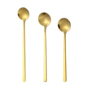
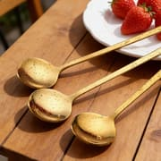
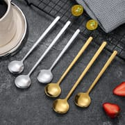
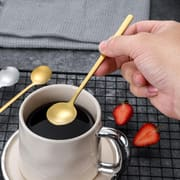
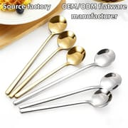
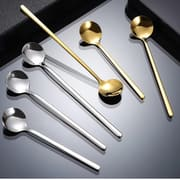
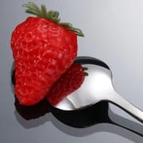
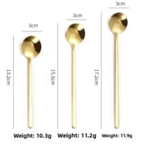

<!-- 面包屑 -->

  <a href="/">Home</a> / <a href="/products">Products</a> / Long Handle Coffee Spoon

<!-- 产品主区域 -->

  <!-- 左侧图片 -->
  

    
    

      
      
      
      
      
      
      
      
    

  

  <!-- 右侧信息 -->
  

    <h1>Long Handle Coffee Spoon — Stainless Steel Stirring Spoon, Gold &amp; Silver</h1>
    
SKU: DY-CS3-001 | Model: Long Handle Coffee Spoon Series

    
Contact us for current wholesale pricing.

    

      &#10003; Three Lengths: 13.2 / 15.3 / 17.2 cm
      &#10003; 10 ml Round Bowl
      &#10003; Gold Plated &amp; Silver
      &#10003; Mirror Polish
      &#10003; Dishwasher Safe
      &#10003; OEM/ODM Available
    

    <h3 style="font-size:1em; margin:22px 0 10px;">Available Lengths</h3>
    

      
<strong>13.2 cm</strong>10.3 g

      
<strong>15.3 cm</strong>11.2 g

      
<strong>17.2 cm</strong>11.9 g

    

    
Same 3 cm round bowl and 10 ml capacity across all three lengths &mdash; mix lengths in one order.

    <!-- 快速询盘 -->
    

      <h3>Quick Inquiry</h3>
      <form action="https://api.web3forms.com/submit" method="POST">
        <input type="hidden" name="access_key" value="{{ site.web3forms_access_key }}">
        <input type="hidden" name="subject" value="New Inquiry: Long Handle Coffee Spoon">
        <input type="hidden" name="redirect" id="form-redirect" value="">
        
        <input type="checkbox" name="botcheck" class="hidden" style="display:none;" tabindex="-1" autocomplete="off">
        

          

            <input type="text" name="name" placeholder="Your Name" required>
          

          

            <input type="email" name="email" placeholder="Email Address" required>
          

        

        

          

            <select name="quantity" required>
              <option value="">Select Quantity</option>
              <option value="Samples first">Samples first</option>
              <option value="Not sure yet">Not sure yet &mdash; please advise</option>
              <option value="1000-3000">1,000 - 3,000 pcs</option>
              <option value="3000-5000">3,000 - 5,000 pcs</option>
              <option value="5000-10000">5,000 - 10,000 pcs</option>
              <option value="10000+">10,000+ pcs</option>
            </select>
          

          

            <input type="text" name="country" placeholder="Destination Country" required>
          

        

        <button type="submit" class="inquiry-btn">Send Inquiry Now</button>
      </form>
    

    

      <strong>Need samples?</strong> Samples available on request, refundable on bulk orders.
      <a href="mailto:sales@ding-yong.com?subject=Sample Request: Long Handle Coffee Spoon" style="color:#e94560;">Request Sample &rarr;</a>
    

  

<!-- 标签页内容 -->

  

    <button class="tab-btn active" onclick="switchTab('specs')">Specifications</button>
    <button class="tab-btn" onclick="switchTab('packaging')">Packaging</button>
    <button class="tab-btn" onclick="switchTab('certification')">Quality</button>
    <button class="tab-btn" onclick="switchTab('shipping')">Shipping &amp; Logistics</button>
  

  <!-- 规格参数 -->
  

    <h2>Product Specifications</h2>
    <table class="spec-table">
      <tr><td>Material</td><td>Stainless steel</td></tr>
      <tr><td>Finish</td><td>Mirror polish; gold plated or polished silver</td></tr>
      <tr><td>Bowl</td><td>Round bowl, 3 cm diameter, 10 ml (0.34 fl oz) capacity</td></tr>
      <tr><td>Handle</td><td>Long straight slim handle, same profile on all lengths</td></tr>
      <tr><td>Lengths Available</td><td>13.2 cm / 15.3 cm / 17.2 cm</td></tr>
      <tr><td>Weight</td><td>10.3 g / 11.2 g / 11.9 g by length</td></tr>
      <tr><td>Typical Use</td><td>Stirring coffee and tea, serving small desserts, cafe and hotel service</td></tr>
      <tr><td>Care</td><td>Dishwasher safe; hand wash recommended to keep the gold tone long-term</td></tr>
      <tr><td>Customization</td><td>Laser logo engraving, finish colour, custom packaging or boxed set</td></tr>
    </table>

    <h3 style="margin-top:30px;">Lengths &amp; Weights</h3>
    <table class="spec-table">
      <tr><td>13.2 cm</td><td>3 cm bowl &middot; 10 ml &middot; 10.3 g</td></tr>
      <tr><td>15.3 cm</td><td>3 cm bowl &middot; 10 ml &middot; 11.2 g</td></tr>
      <tr><td>17.2 cm</td><td>3 cm bowl &middot; 10 ml &middot; 11.9 g</td></tr>
    </table>

    

      The same gold mirror finish is also available as a full five-piece place setting &mdash;
      see the <a href="/products/square-handle-gold-5-piece-flatware-set/" style="color:#e94560;">Square Handle Gold 5-Piece Flatware Set</a>.
    

  

  <!-- 包装信息 -->
  

    <h2>Packaging Options</h2>
    <table class="spec-table">
      <tr><td>Standard Packing</td><td>1 pc per poly bag, bulk packed in export carton</td></tr>
      <tr><td>Boxed Set</td><td>3-piece, 6-piece or 12-piece spoon sets in a printed colour box or gift box on request</td></tr>
      <tr><td>Custom Printing</td><td>Logo, insert card, barcode label and hang tag</td></tr>
      <tr><td>Carton Details</td><td>Carton size, pieces per carton and gross weight are confirmed per order against your quantity and destination</td></tr>
    </table>
    

      Send us your packaging brief and target market &mdash; we will come back with a carton plan and retail-ready options.
      <a href="mailto:sales@ding-yong.com?subject=Packaging Request: Long Handle Coffee Spoon" style="color:#e94560;">Request Packaging Options &rarr;</a>
    

  

  <!-- 质检 -->
  

    <h2>Quality Assurance</h2>
    

      

        
&#9989;

        <strong>Sample Confirmation</strong>
        
Approve samples before bulk production

      

      

        
&#128230;

        <strong>Pre-shipment Inspection</strong>
        
Every order checked before packing

      

      

        
&#128300;

        <strong>Third-party Testing</strong>
        
SGS or other labs arranged on request

      

      

        
&#127970;

        <strong>Factory Audit</strong>
        
On-site visits or video inspection welcome

      

    

    

      Inspection records and quality documents available upon request.
      <a href="mailto:sales@ding-yong.com?subject=Quality Documents Request" style="color:#e94560;">Request Documents &rarr;</a>
    

  

  <!-- 运输支付 -->
  

    <h2>Shipping &amp; Logistics</h2>
    <table class="spec-table">
      <tr><td>Trade Terms</td><td>FOB Shenzhen / Guangzhou, CIF, DDP (select destinations)</td></tr>
      <tr><td>Port</td><td>Shenzhen / Guangzhou / Shantou</td></tr>
      <tr><td>Shipping</td><td>Sea freight (FCL/LCL), Air freight, Express (DHL/FedEx/UPS)</td></tr>
      <tr><td>Insurance</td><td>All-risk marine insurance available</td></tr>
    </table>
  

<!-- 相关产品 -->

  <h2>You May Also Like</h2>
  

    
    
    
    
    

      
      <h4><a href="{{ p.url }}" style="color:#1a1a2e; text-decoration:none;">{{ p.title }}</a></h4>
      
{{ p.price }}Contact Us

    

    
  

<!-- 底部CTA -->

  <h2>Ready to Order?</h2>
  
Get your custom quote within 24 hours. Free sample available for serious buyers.

  <a href="/contact" class="cta-button">Get Free Quote</a>
  <a href="https://wa.me/8615013371880" class="cta-button secondary" target="_blank">Chat on WhatsApp</a>

