

<!-- Product main area -->

  <!-- Left: gallery -->
  

    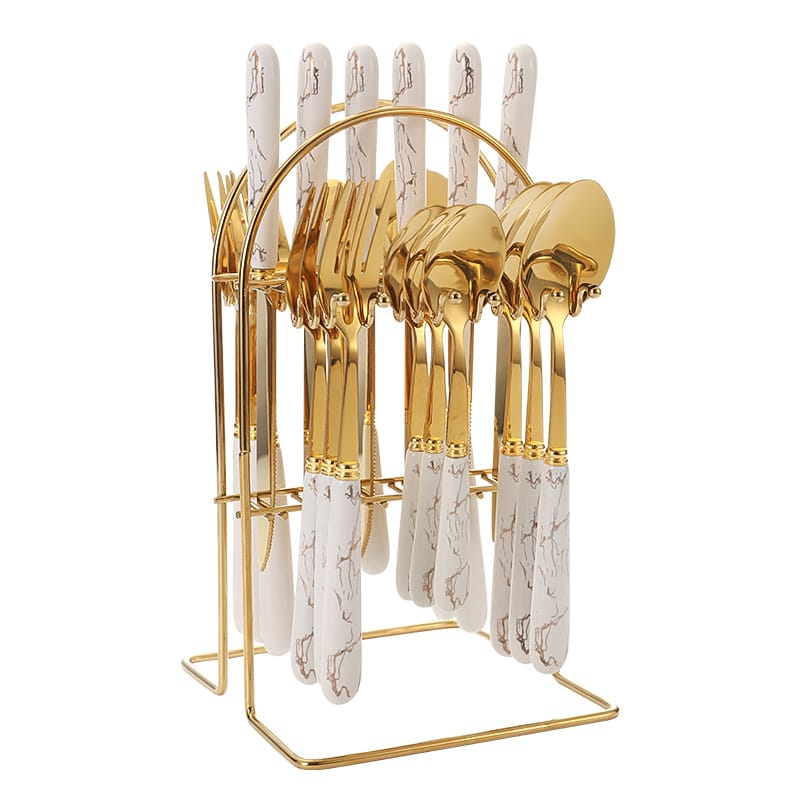
    

      
      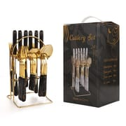
      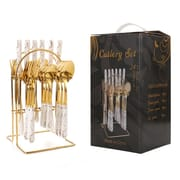
      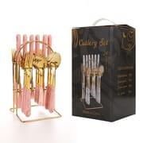
      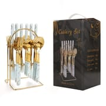
      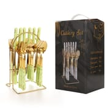
      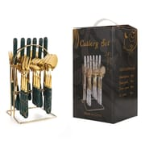
      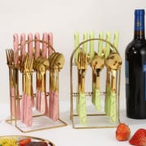
      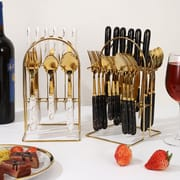
      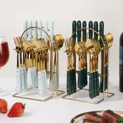
      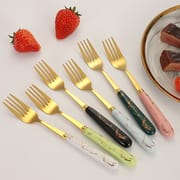
      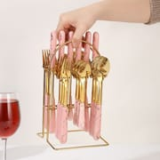
    

  

  <!-- Right: info -->
  

    <h1>Ménagère 24 pièces en acier inoxydable à manche céramique — vente en gros &amp; OEM</h1>
    

      Une ménagère 24 pièces en acier inoxydable pensée pour la vente en gros et le retail :
      6 couteaux de table, 6 fourchettes, 6 cuillères et 6 petites cuillères, chacune avec un manche
      céramique motif marbre et une tête dorée poli miroir. Livrée dans un coffret cadeau avec
      support doré ; gravure laser du logo et emballage personnalisé disponibles en OEM/ODM.
    

    
Réf. : DY-CH24-001 | Série : céramique marbre

    
Contactez-nous pour les prix de gros en vigueur.

    

      ✓ Acier inoxydable + manche céramique
      ✓ Manche motif marbre
      ✓ Tête dorée poli miroir
      ✓ 6 options de couleur
      ✓ Support + coffret cadeau
      ✓ OEM/ODM disponible
    

    <!-- Quick inquiry -->
    

      <h3>Demande rapide</h3>
      <form action="https://api.web3forms.com/submit" method="POST">
        <input type="hidden" name="access_key" value="{{ site.web3forms_access_key }}">
        <input type="hidden" name="subject" value="New Inquiry (FR page): Marble-Pattern Ceramic Handle 24-Piece Cutlery Set with Display Stand">
        <input type="hidden" name="redirect" id="form-redirect" value="">
        
        <input type="checkbox" name="botcheck" class="hidden" style="display:none;" tabindex="-1" autocomplete="off">
        

          

            <input type="text" name="name" placeholder="Votre nom" required>
          

          

            <input type="email" name="email" placeholder="Adresse email" required>
          

        

        

          

            <select name="quantity" required>
              <option value="">Choisir la quantité</option>
              <option value="Samples first">D'abord des échantillons</option>
              <option value="Not sure yet">Pas encore sûr &mdash; merci de conseiller</option>
              <option value="500-1000">500 - 1 000 lots</option>
              <option value="1000-3000">1 000 - 3 000 lots</option>
              <option value="3000-10000">3 000 - 10 000 lots</option>
              <option value="10000+">Plus de 10 000 lots</option>
            </select>
          

          

            <input type="text" name="country" placeholder="Pays de destination" required>
          

        

        <button type="submit" class="inquiry-btn">Envoyer la demande</button>
      </form>
    

    

      <strong>Des échantillons ?</strong> Échantillons disponibles sur demande, remboursés sur les commandes en volume.
      <a href="mailto:sales@ding-yong.com?subject=Sample Request: Ceramic Handle 24-Piece Cutlery Set" style="color:#e94560;">Demander un échantillon &rarr;</a>
    

    

      <strong>Coffret &amp; logo ?</strong> Coffret, couleur et artwork personnalisés avec votre propre logo.
      <a href="mailto:sales@ding-yong.com?subject=Gift Box Request: Ceramic Handle 24-Piece Cutlery Set" style="color:#e94560;">Demander la personnalisation &rarr;</a>
    

  

<!-- Tabs -->

  

    <button class="tab-btn active" onclick="switchTab('specs')">Caractéristiques</button>
    <button class="tab-btn" onclick="switchTab('packaging')">Emballage</button>
    <button class="tab-btn" onclick="switchTab('certification')">Qualité</button>
    <button class="tab-btn" onclick="switchTab('shipping')">Logistique</button>
  

  <!-- Specifications -->
  

    <h2>Caractéristiques techniques</h2>
    <table class="spec-table">
      <tr><td>Matériau</td><td>Acier inoxydable (couverts) + céramique (manche)</td></tr>
      <tr><td>Finition</td><td>Tête dorée poli miroir, manche céramique motif marbre</td></tr>
      <tr><td>Composition</td><td>6 × couteaux de table + 6 × fourchettes + 6 × cuillères + 6 × petites cuillères (24 pièces au total)</td></tr>
      <tr><td>Couteau de table</td><td>20 cm, 44,3 g</td></tr>
      <tr><td>Fourchette de table</td><td>18,7 cm, 36 g</td></tr>
      <tr><td>Cuillère de table</td><td>19,2 cm, 45,4 g</td></tr>
      <tr><td>Petite cuillère</td><td>15,2 cm, 25,7 g</td></tr>
      <tr><td>Support de présentation</td><td>23 cm de haut, base 13 × 14 cm &mdash; support suspendu métallique doré</td></tr>
      <tr><td>Coffret</td><td>24 × 15,5 × 13,5 cm avec poignée</td></tr>
      <tr><td>Options de couleur</td><td>Blanc céramique / bleu nordique / vert encre / noir / vert nordique / rose nordique</td></tr>
      <tr><td>Points forts</td><td>Manche céramique isolant thermiquement et agréable en main ; bords arrondis lisses sans bavures ; surface poli miroir, facile à nettoyer et résistante à la rouille</td></tr>
      <tr><td>Usage</td><td>Restauration occidentale / restaurant / maison, cadeaux et retail</td></tr>
      <tr><td>Personnalisation</td><td>Logo sur mesure, couleur sur mesure, coffret et emballage personnalisés (OEM/ODM)</td></tr>
    </table>
    
Les dimensions sont prises à la main &mdash; une petite tolérance est normale. Se référer au produit réel.

    <h3 style="margin-top:30px;">Couleurs disponibles</h3>
    

      

Blanc céramique

      

Bleu nordique

      

Vert encre

      

Noir

      

Vert nordique

      

Rose nordique

    

    
Les six couleurs sont visibles dans la galerie ci-dessus. Couleurs de manche et finitions sur demande.

  

  <!-- Packaging -->
  

    <h2>Options d'emballage</h2>
    
Chaque ménagère 24 pièces est présentée sur son support doré et conditionnée dans un coffret avec poignée &mdash; prête pour le retail dès la sortie du carton. Couleur du coffret, logo et artwork personnalisables selon votre design (OEM/ODM).

    

      

        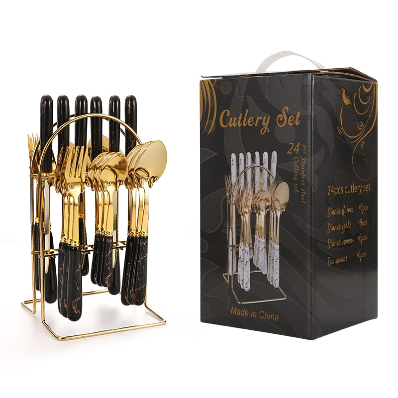
        <h4>Présentation en coffret</h4>
        
Coffret avec poignée 24 × 15,5 × 13,5 cm.

      

      

        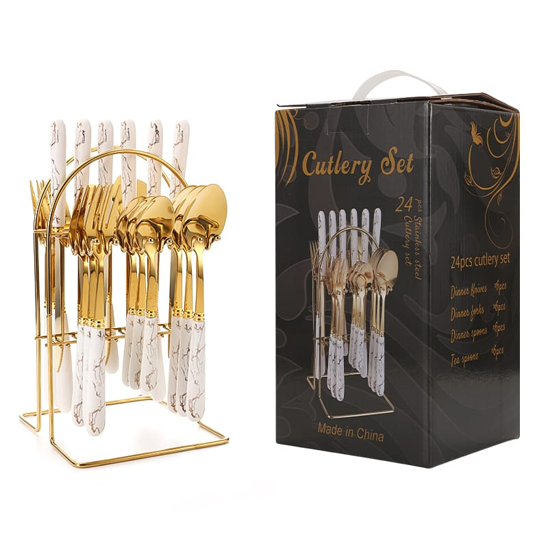
        <h4>Blanc céramique</h4>
        
Le lot complet sur son support dans le coffret.

      

      

        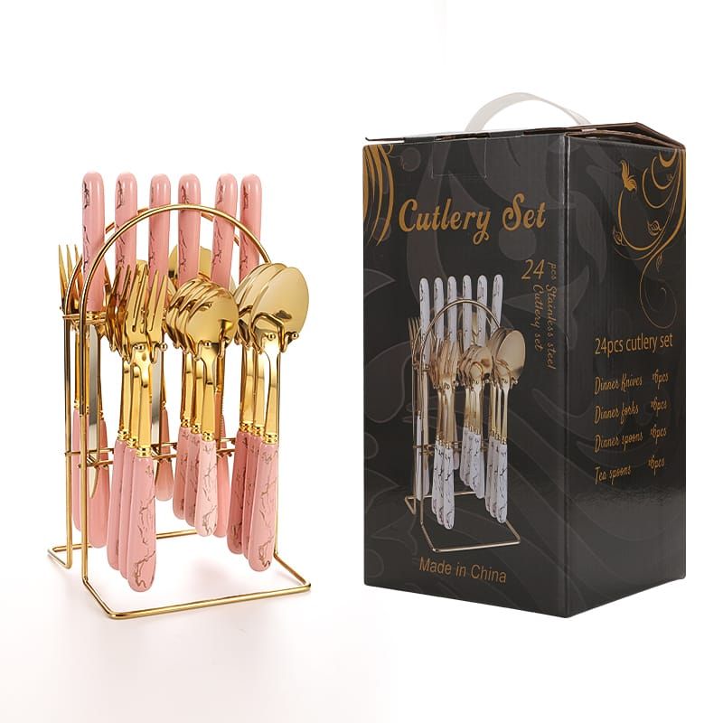
        <h4>Rose nordique</h4>
        
Six couleurs de manche au choix.

      

      

        
        <h4>Support + lot</h4>
        
Le support suspendu doré garde le lot bien rangé.

      

    

    

      <h4>Emballage standard</h4>
      <table class="spec-table">
        <tr><td>Conditionnement intérieur</td><td>Ménagère 24 pièces complète sur le support, dans le coffret</td></tr>
        <tr><td>Coffret</td><td>24 × 15,5 × 13,5 cm avec poignée</td></tr>
        <tr><td>Lots mixtes</td><td>Couleurs de manche et compositions de lot mixables à la commande</td></tr>
        <tr><td>Emballage personnalisé</td><td>Coffret sur mesure, boîte couleur, impression logo et marque propre disponibles (OEM/ODM)</td></tr>
      </table>
    

  

  <!-- Quality -->
  

    <h2>Assurance qualité</h2>
    

      

        
&#9989;

        <strong>Confirmation d'échantillon</strong>
        
Validation des échantillons avant la production en série

      

      

        
&#128230;

        <strong>Inspection avant expédition</strong>
        
Chaque commande contrôlée avant emballage

      

      

        
&#128300;

        <strong>Tests en laboratoire indépendant</strong>
        
SGS ou autres laboratoires, à la demande

      

      

        
&#127970;

        <strong>Audit d'usine</strong>
        
Visites sur site ou inspection par visioconférence

      

    

    

      Rapports d'inspection et documents qualité disponibles sur demande.
      <a href="mailto:sales@ding-yong.com?subject=Quality Documents Request" style="color:#e94560;">Demander les documents &rarr;</a>
    

  

  <!-- Shipping -->
  

    <h2>Logistique &amp; transport</h2>
    <table class="spec-table">
      <tr><td>Incoterms</td><td>FOB Shenzhen / Guangzhou, CIF, DDP (certaines destinations)</td></tr>
      <tr><td>Ports</td><td>Shenzhen / Guangzhou / Shantou</td></tr>
      <tr><td>Transport</td><td>Maritime (conteneur complet/groupage), aérien, express (DHL/FedEx/UPS)</td></tr>
      <tr><td>Assurance</td><td>Assurance transport tous risques disponible</td></tr>
    </table>
  

<!-- Related products（法语集合） -->

  <h2>Vous aimerez aussi</h2>
  

    
    
    

      
      <h4><a href="{{ p.url }}" style="color:#1a1a2e; text-decoration:none;">{{ p.title }}</a></h4>
      
Contactez-nous

    

    
  

<!-- Bottom CTA -->

  <h2>Prêt à commander ?</h2>
  
Recevez votre devis personnalisé sous 24 heures. Échantillon gratuit pour les acheteurs sérieux.

  <a href="/fr/contact/" class="cta-button">Obtenir un devis gratuit</a>
  <a href="https://wa.me/8615013371880" class="cta-button secondary" target="_blank">Discuter sur WhatsApp</a>

