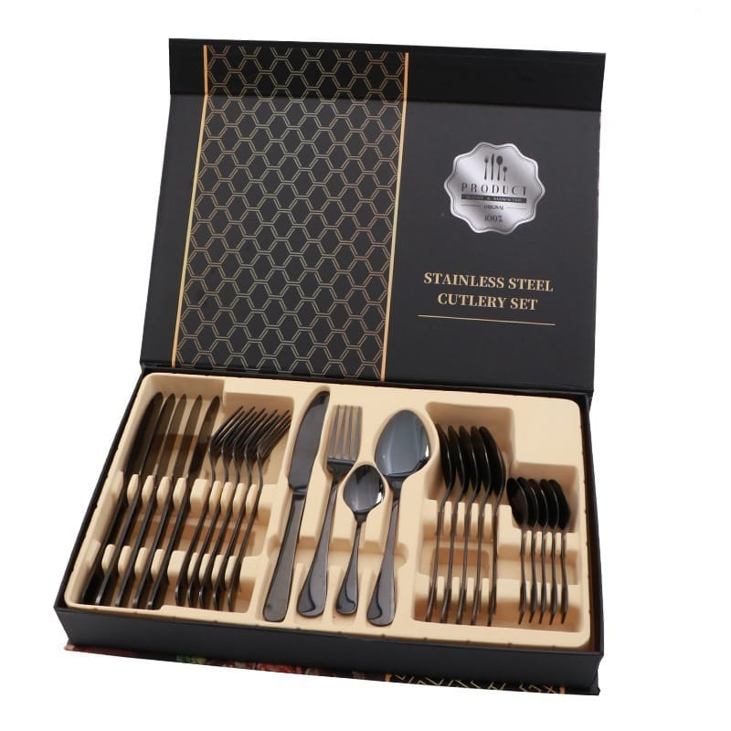
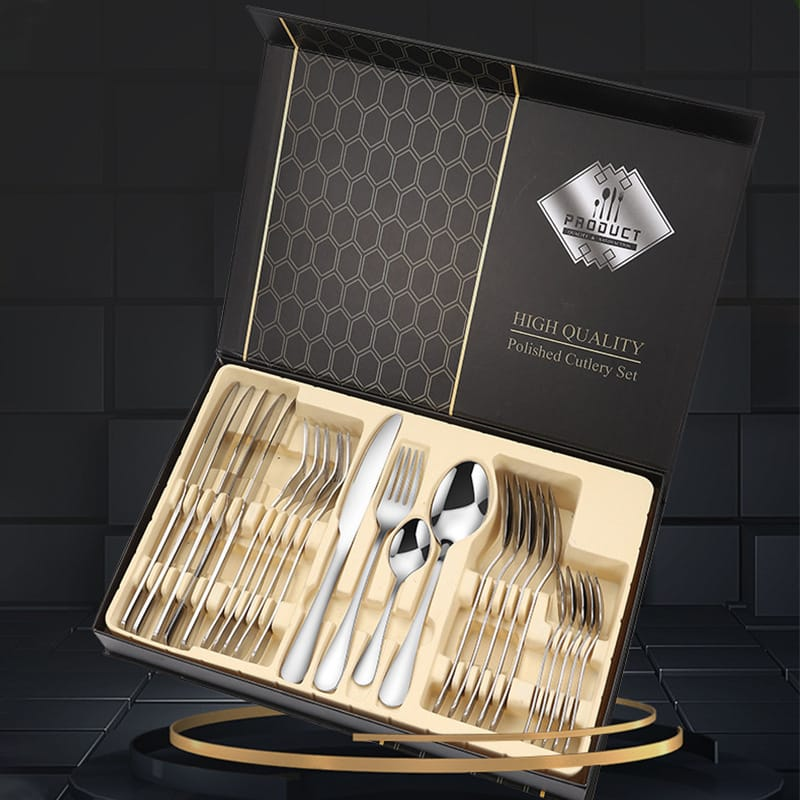
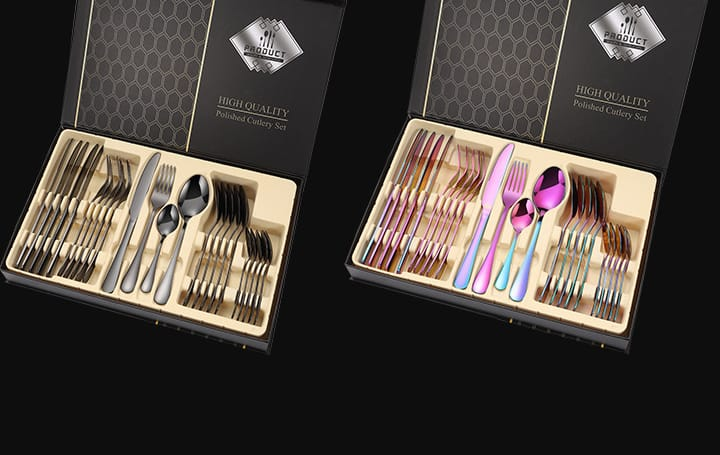
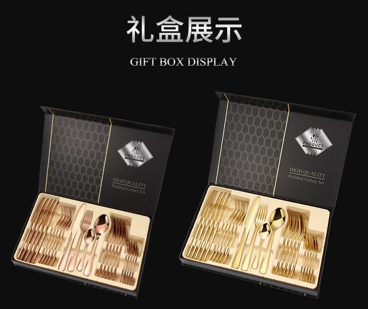
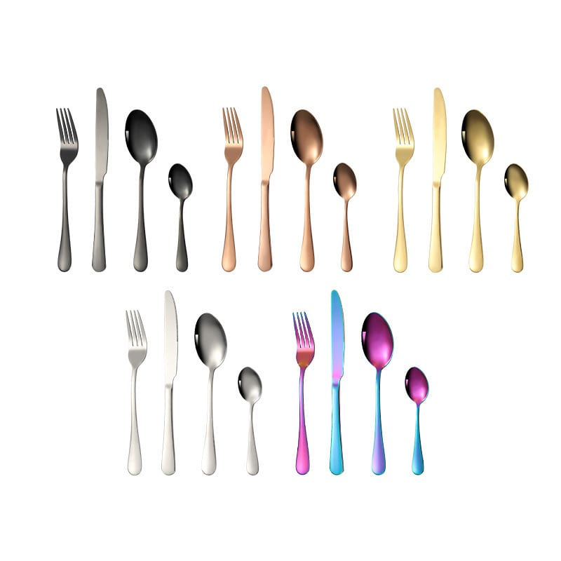
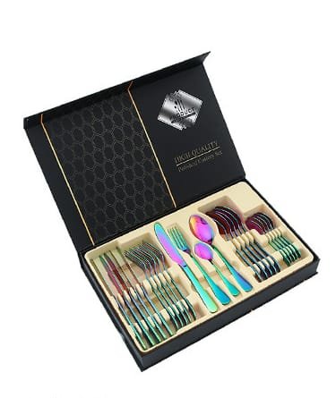
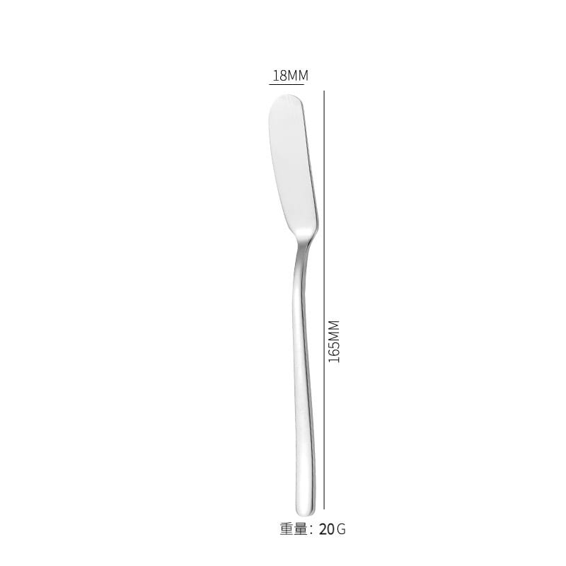
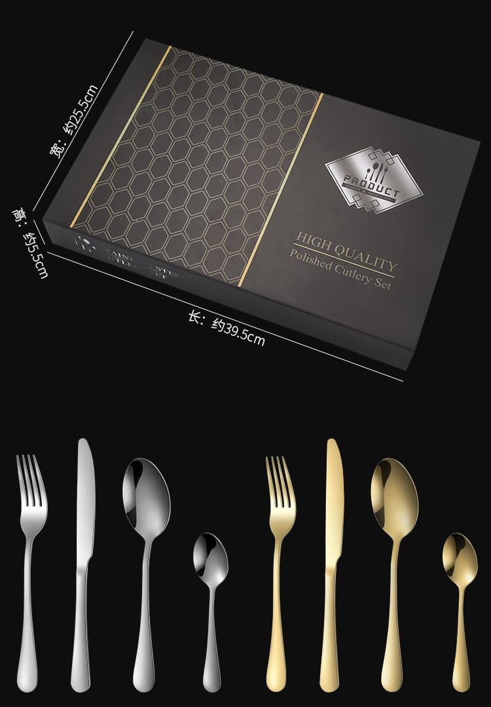
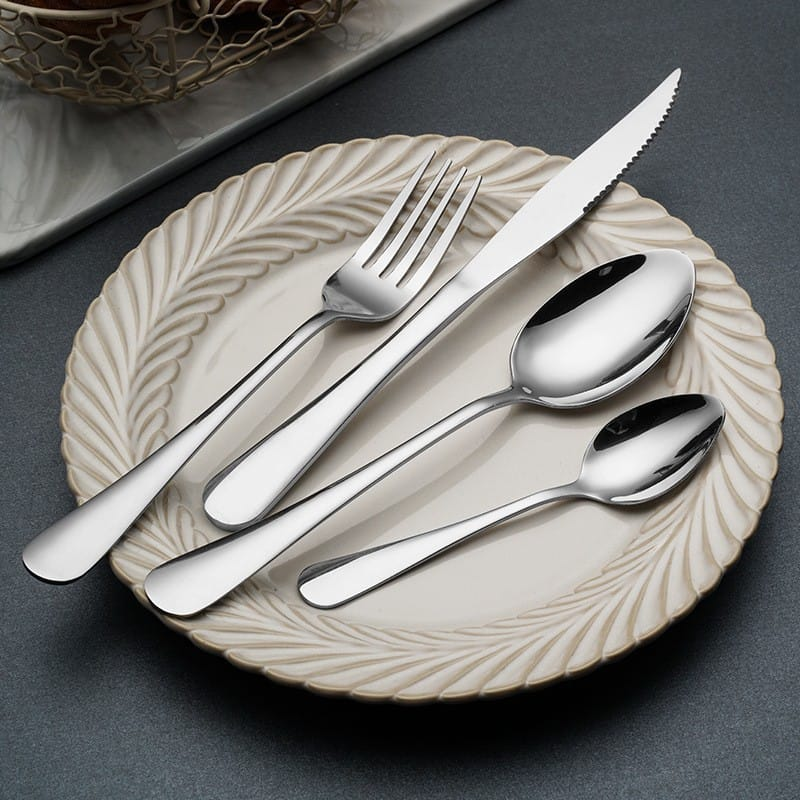

<!-- 面包屑 -->

  <a href="/fr/">Accueil</a> / <a href="/fr/produits/">Produits</a> / Ménagère 24 pièces dorée avec coffret

<!-- 产品主区域 -->

  <!-- 左侧图片 -->
  

    
    

      
      
      
      
      
      
      
      
      
    

  

  <!-- 右侧信息 -->
  

    <h1>Ménagère 24 pièces dorée en acier inoxydable 1010 avec coffret cadeau</h1>
    
Réf. : DY-GB24-001 | Série : coffret 1010

    
Contactez-nous pour les prix de gros en vigueur.

    

      ✓ Acier inoxydable 1010
      ✓ Dorure PVD
      ✓ 5 options de couleur
      ✓ Coffret premium
      ✓ OEM/ODM disponible
    

    <!-- 快速询盘 -->
    

      <h3>Demande rapide</h3>
      <form action="https://api.web3forms.com/submit" method="POST">
        <input type="hidden" name="access_key" value="{{ site.web3forms_access_key }}">
        <input type="hidden" name="subject" value="New Inquiry (FR page): 24-Piece Gold-Plated Cutlery Set with Gift Box">
        <input type="hidden" name="redirect" id="form-redirect" value="">
        
        <input type="checkbox" name="botcheck" class="hidden" style="display:none;" tabindex="-1" autocomplete="off">
        

          

            <input type="text" name="name" placeholder="Votre nom" required>
          

          

            <input type="email" name="email" placeholder="Adresse email" required>
          

        

        

          

            <select name="quantity" required>
              <option value="">Choisir la quantité</option>
              <option value="Samples first">D'abord des échantillons</option>
              <option value="Not sure yet">Pas encore sûr &mdash; merci de conseiller</option>
              <option value="20-100">20 - 100 pièces</option>
              <option value="100-500">100 - 500 pièces</option>
              <option value="500-1000">500 - 1 000 pièces</option>
              <option value="1000+">Plus de 1 000 pièces</option>
            </select>
          

          

            <input type="text" name="country" placeholder="Pays de destination" required>
          

        

        <button type="submit" class="inquiry-btn">Envoyer la demande</button>
      </form>
    

    

      <strong>Des échantillons ?</strong> Échantillons disponibles sur demande, remboursés sur les commandes en volume.
      <a href="mailto:sales@ding-yong.com?subject=Sample Request: 24-Piece Gold-Plated Cutlery Set" style="color:#e94560;">Demander un échantillon &rarr;</a>
    

  

<!-- 标签页内容 -->

  

    <button class="tab-btn active" onclick="switchTab('specs')">Caractéristiques</button>
    <button class="tab-btn" onclick="switchTab('packaging')">Emballage</button>
    <button class="tab-btn" onclick="switchTab('certification')">Qualité</button>
    <button class="tab-btn" onclick="switchTab('shipping')">Logistique</button>
  

  <!-- 规格参数 -->
  

    <h2>Caractéristiques techniques</h2>
    <table class="spec-table">
      <tr><td>Matériau</td><td>Acier inoxydable 1010</td></tr>
      <tr><td>Finition</td><td>Dorure PVD / poli miroir</td></tr>
      <tr><td>Composition</td><td>6 × couteaux de table + 6 × fourchettes + 6 × cuillères + 6 × petites cuillères (24 pièces au total)</td></tr>
      <tr><td>Couteau de table</td><td>22,8 cm / 76 g</td></tr>
      <tr><td>Fourchette de table</td><td>20,5 cm / 38 g</td></tr>
      <tr><td>Cuillère de table</td><td>20,5 cm / 51 g</td></tr>
      <tr><td>Petite cuillère</td><td>13,9 cm / 22 g</td></tr>
      <tr><td>Taille du coffret</td><td>39,5 × 25,5 × 5,5 cm</td></tr>
      <tr><td>Poids du lot</td><td>Environ 1,655 kg / lot (avec coffret)</td></tr>
      <tr><td>Options de couleur</td><td>Doré / or rose / argent / noir / multicolore (arc-en-ciel)</td></tr>
      <tr><td>Lave-vaisselle</td><td>Oui</td></tr>
      <tr><td>Personnalisation</td><td>Logo laser, couleur sur mesure, emballage personnalisé</td></tr>
    </table>

    <h3 style="margin-top:30px;">Couleurs disponibles</h3>
    

      

Doré

      

Or rose

      

Argent

      

Noir

      

Arc-en-ciel (sur mesure)

    

  

  <!-- 包装信息 -->
  

    <h2>Options d'emballage</h2>
    

      

        
        <h4>Coffret premium</h4>
        
Coffret noir à motif doré, 39,5 × 25,5 × 5,5 cm.

      

      

        
        <h4>Présentation prête au retail</h4>
        
Mise en scène élégante, idéale pour linéaires et cadeaux.

      

      

        
        <h4>Coffret OEM sur mesure</h4>
        
Logo et design d'emballage personnalisés sur demande.

      

    

    

      <h4>Informations sur le carton extérieur</h4>
      <table class="spec-table">
        <tr><td>Taille du carton</td><td>53 × 42,5 × 35 cm</td></tr>
        <tr><td>Quantité</td><td>12 coffrets / carton</td></tr>
        <tr><td>Poids brut</td><td>21 kg / carton</td></tr>
        <tr><td>Poids du lot</td><td>Environ 1,655 kg / lot (avec coffret)</td></tr>
        <tr><td>Note d'emballage</td><td>12 coffrets par carton recommandés, bien calés contre les chocs</td></tr>
      </table>
    

  

  <!-- 质检 -->
  

    <h2>Assurance qualité</h2>
    

      

        
&#9989;

        <strong>Confirmation d'échantillon</strong>
        
Validation des échantillons avant la production en série

      

      

        
&#128230;

        <strong>Inspection avant expédition</strong>
        
Chaque commande contrôlée avant emballage

      

      

        
&#128300;

        <strong>Tests en laboratoire indépendant</strong>
        
SGS ou autres laboratoires, à la demande

      

      

        
&#127970;

        <strong>Audit d'usine</strong>
        
Visites sur site ou inspection par visioconférence

      

    

    

      Rapports d'inspection et documents qualité disponibles sur demande.
      <a href="mailto:sales@ding-yong.com?subject=Quality Documents Request" style="color:#e94560;">Demander les documents &rarr;</a>
    

  

  <!-- 运输支付 -->
  

    <h2>Logistique &amp; transport</h2>
    <table class="spec-table">
      <tr><td>Incoterms</td><td>FOB Shenzhen / Guangzhou, CIF, DDP (certaines destinations)</td></tr>
      <tr><td>Ports</td><td>Shenzhen / Guangzhou / Shantou</td></tr>
      <tr><td>Transport</td><td>Maritime (conteneur complet/groupage), aérien, express (DHL/FedEx/UPS)</td></tr>
      <tr><td>Assurance</td><td>Assurance transport tous risques disponible</td></tr>
    </table>
  

<!-- 相关产品（法语集合） -->

  <h2>Vous aimerez aussi</h2>
  

    
    
    

      
      <h4><a href="{{ p.url }}" style="color:#1a1a2e; text-decoration:none;">{{ p.title }}</a></h4>
      
Contactez-nous

    

    
  

<!-- 底部CTA -->

  <h2>Prêt à commander ?</h2>
  
Recevez votre devis personnalisé sous 24 heures. Échantillon gratuit pour les acheteurs sérieux.

  <a href="/fr/contact/" class="cta-button">Obtenir un devis gratuit</a>
  <a href="https://wa.me/8615013371880" class="cta-button secondary" target="_blank">Discuter sur WhatsApp</a>

