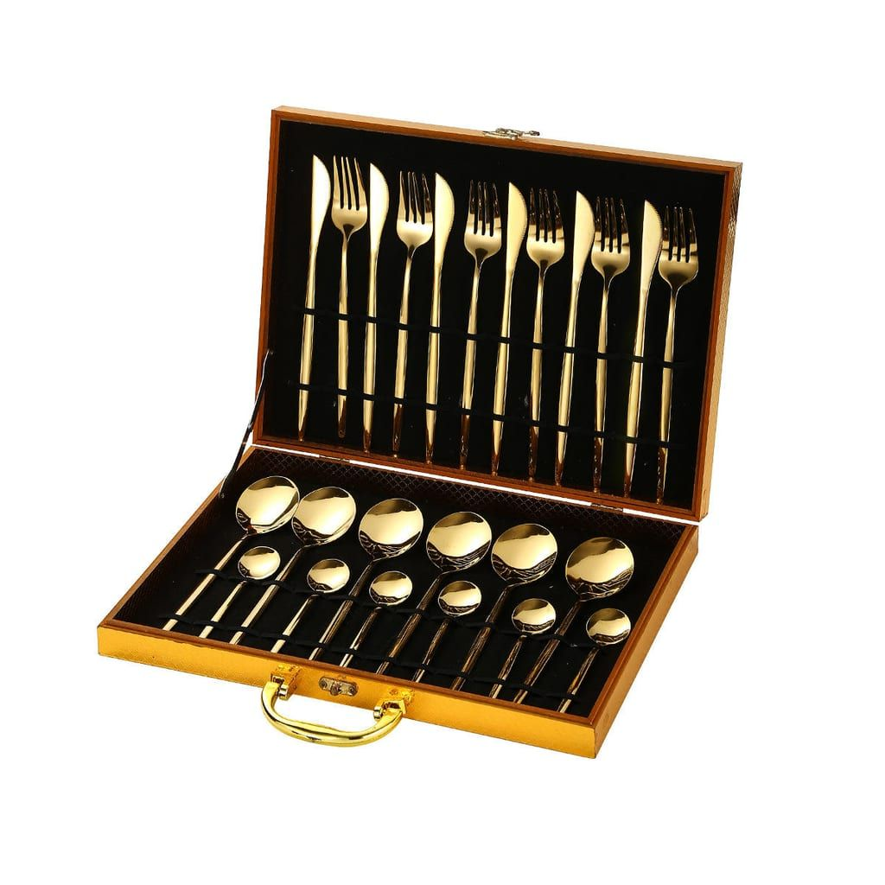
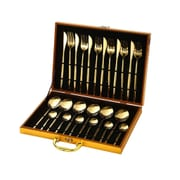
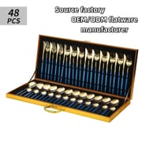
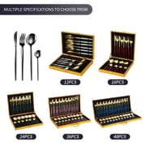
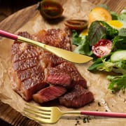
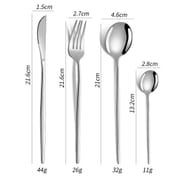
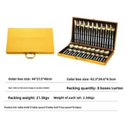
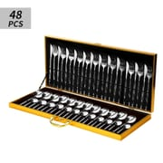
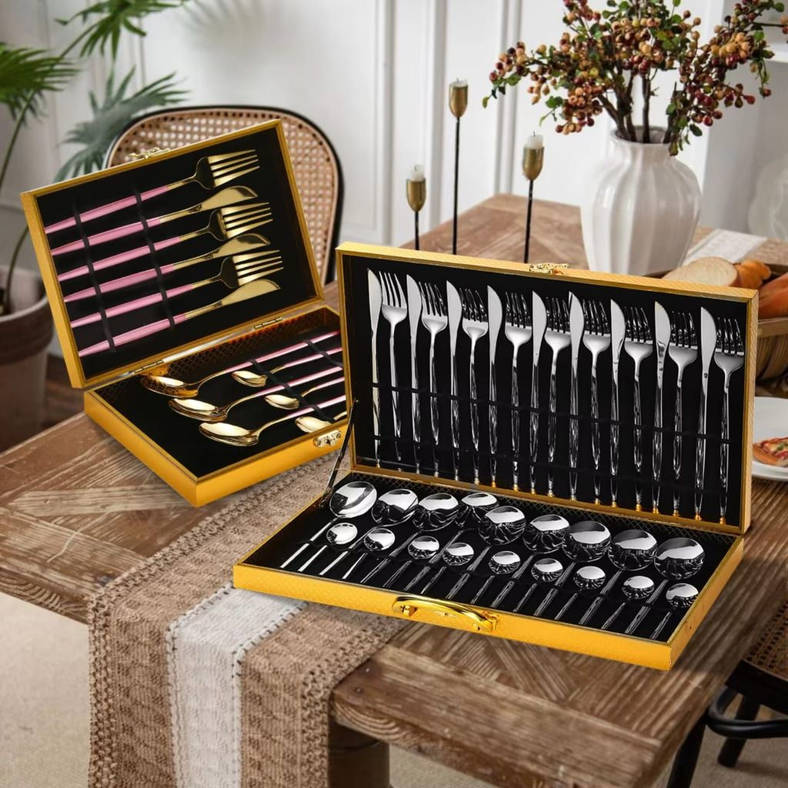

<!-- 面包屑 -->

  <a href="/fr/">Accueil</a> / <a href="/fr/produits/">Produits</a> / Ménagère multi-formats en coffret

<!-- 产品主区域 -->

  <!-- 左侧图片 -->
  

    
    

      
      
      
      
      
      
      
      
    

  

  <!-- 右侧信息 -->
  

    <h1>Ménagère 12&ndash;48 pièces en coffret en bois</h1>
    
Réf. : DY-MG48-001 | Série : Ménagère multi-formats en coffret

    
Contactez-nous pour les prix de gros en vigueur.

    

      &#10003; Acier inoxydable
      &#10003; Poli miroir
      &#10003; 5 formats : 12&ndash;48 pièces
      &#10003; Coffret en bois
      &#10003; Doré / Argent / Noir / Multicolore
      &#10003; OEM/ODM disponible
    

    <!-- 快速询盘 -->
    

      <h3>Demande rapide</h3>
      <form action="https://api.web3forms.com/submit" method="POST">
        <input type="hidden" name="access_key" value="{{ site.web3forms_access_key }}">
        <input type="hidden" name="subject" value="New Inquiry (FR page): Multi-Size Gift Box Cutlery Set">
        <input type="hidden" name="redirect" id="form-redirect" value="">
        
        <input type="checkbox" name="botcheck" class="hidden" style="display:none;" tabindex="-1" autocomplete="off">
        

          

            <input type="text" name="name" placeholder="Votre nom" required>
          

          

            <input type="email" name="email" placeholder="Adresse email" required>
          

        

        

          

            <select name="quantity" required>
              <option value="">Choisir la quantité</option>
              <option value="Samples first">D'abord des échantillons</option>
              <option value="Not sure yet">Pas encore sûr &mdash; merci de conseiller</option>
              <option value="1000-3000">1 000 - 3 000 lots</option>
              <option value="3000-5000">3 000 - 5 000 lots</option>
              <option value="5000-10000">5 000 - 10 000 lots</option>
              <option value="10000+">Plus de 10 000 lots</option>
            </select>
          

          

            <input type="text" name="country" placeholder="Pays de destination" required>
          

        

        <button type="submit" class="inquiry-btn">Envoyer la demande</button>
      </form>
    

    

      <strong>Des échantillons ?</strong> Échantillons disponibles sur demande, remboursés sur les commandes en volume.
      <a href="mailto:sales@ding-yong.com?subject=Sample Request: Multi-Size Gift Box Cutlery Set" style="color:#e94560;">Demander un échantillon &rarr;</a>
    

  

<!-- 标签页内容 -->

  

    <button class="tab-btn active" onclick="switchTab('specs')">Caractéristiques</button>
    <button class="tab-btn" onclick="switchTab('packaging')">Emballage</button>
    <button class="tab-btn" onclick="switchTab('certification')">Qualité</button>
    <button class="tab-btn" onclick="switchTab('shipping')">Logistique</button>
  

  <!-- 规格参数 -->
  

    <h2>Caractéristiques techniques</h2>
    <table class="spec-table">
      <tr><td>Matériau</td><td>Acier inoxydable</td></tr>
      <tr><td>Finition</td><td>Poli miroir &mdash; argent / doré / noir / multicolore (arc-en-ciel)</td></tr>
      <tr><td>Composition</td><td>Chaque couvert : 1 couteau de table + 1 fourchette de table + 1 cuillère de table + 1 petite cuillère</td></tr>
      <tr><td>Configurations</td><td>12 / 16 / 24 / 36 / 48 pièces (3 / 4 / 6 / 9 / 12 couverts complets)</td></tr>
      <tr><td>Coffret</td><td>Coffret rigide en bois, fermoir métallique et intérieur velours assorti</td></tr>
      <tr><td>Personnalisation</td><td>Gravure de logo, couleur de l'intérieur, impression du coffret, configuration sur mesure</td></tr>
    </table>

    <h3 style="margin-top:30px;">Dimensions de chaque pièce</h3>
    <table class="config-table">
      <tr><th>Pièce</th><th>Longueur</th><th>Largeur</th><th>Poids</th></tr>
      <tr><td>Couteau de table</td><td>21,6 cm</td><td>1,5 cm</td><td>44 g</td></tr>
      <tr><td>Fourchette de table</td><td>21,6 cm</td><td>2,7 cm</td><td>26 g</td></tr>
      <tr><td>Cuillère de table</td><td>21 cm</td><td>4,6 cm</td><td>32 g</td></tr>
      <tr><td>Petite cuillère</td><td>13,2 cm</td><td>2,8 cm</td><td>11 g</td></tr>
    </table>

    <h3 style="margin-top:30px;">Configurations disponibles</h3>
    <table class="config-table">
      <tr><th>Lot</th><th>Couverts complets</th><th>Taille du coffret</th><th>Poids brut du coffret</th></tr>
      <tr><td>12 pièces</td><td>3 &times; chaque pièce</td><td>17,3 &times; 26 &times; 4 cm</td><td>1,02 kg</td></tr>
      <tr><td>16 pièces</td><td>4 &times; chaque pièce</td><td>23 &times; 26 &times; 4,5 cm</td><td>1,27 kg</td></tr>
      <tr><td>24 pièces</td><td>6 &times; chaque pièce</td><td>34,6 &times; 25,5 &times; 4,5 cm</td><td>1,38 kg</td></tr>
      <tr><td>36 pièces</td><td>9 &times; chaque pièce</td><td>42,3 &times; 24,6 &times; 4,5 cm</td><td>2,56 kg</td></tr>
      <tr><td>48 pièces</td><td>12 &times; chaque pièce</td><td>58 &times; 25,5 &times; 4,2 cm</td><td>2,62 kg</td></tr>
    </table>
    

      Le poids brut comprend le coffret en bois, et non les seuls couverts.
    

    <h3 style="margin-top:30px;">Options de finition</h3>
    

      

Argent

      

Doré

      

Noir

      

Multicolore

    

    

      Manches bicolores (corps doré avec manche coloré) également disponibles. La couleur de l'intérieur du coffret peut être assortie à votre commande.
    

  

  <!-- 包装信息 -->
  

    <h2>Emballage &amp; données carton</h2>
    

      

        
        <h4>Coffret &amp; carton</h4>
        
Chaque lot est présenté dans un coffret rigide en bois, puis placé dans un carton extérieur.

      

      

        
        <h4>Coffret en bois</h4>
        
Fermoir métallique, intérieur velours, adapté au retail et aux cadeaux d'entreprise.

      

      

        
        <h4>Finition argent</h4>
        
Acier inoxydable poli miroir, configuration 48 pièces présentée.

      

    

    

      <h4>Informations sur le carton extérieur</h4>
      <table class="config-table">
        <tr><th>Lot</th><th>Lots par carton</th><th>Taille du carton</th><th>Poids brut du carton</th></tr>
        <tr><td>12 pièces</td><td>24 lots</td><td>55 &times; 27,7 &times; 36 cm</td><td>25,6 kg</td></tr>
        <tr><td>16 pièces</td><td>12 lots</td><td>48 &times; 27,5 &times; 28 cm</td><td>16 kg</td></tr>
        <tr><td>24 pièces</td><td>12 lots</td><td>55 &times; 36 &times; 30,5 cm</td><td>17,5 kg</td></tr>
        <tr><td>36 pièces</td><td>8 lots</td><td>44 &times; 27,5 &times; 40 cm</td><td>21,5 kg</td></tr>
        <tr><td>48 pièces</td><td>8 lots</td><td>60 &times; 27,5 &times; 40 cm</td><td>21,9 kg</td></tr>
      </table>
      

        Les chiffres ci-dessus correspondent à l'emballage standard. L'impression d'un logo sur le coffret est disponible.
      

    

  

  <!-- 质检 -->
  

    <h2>Assurance qualité</h2>
    

      

        
&#9989;

        <strong>Confirmation d'échantillon</strong>
        
Validation des échantillons avant la production en série

      

      

        
&#128230;

        <strong>Inspection avant expédition</strong>
        
Chaque commande contrôlée avant emballage

      

      

        
&#128300;

        <strong>Tests en laboratoire indépendant</strong>
        
SGS ou autres laboratoires, à la demande

      

      

        
&#127970;

        <strong>Audit d'usine</strong>
        
Visites sur site ou inspection par visioconférence

      

    

    

      Rapports d'inspection et documents qualité disponibles sur demande.
      <a href="mailto:sales@ding-yong.com?subject=Quality Documents Request" style="color:#e94560;">Demander les documents &rarr;</a>
    

  

  <!-- 运输支付 -->
  

    <h2>Logistique &amp; transport</h2>
    <table class="spec-table">
      <tr><td>Incoterms</td><td>FOB Shenzhen / Guangzhou, CIF, DDP (certaines destinations)</td></tr>
      <tr><td>Ports</td><td>Shenzhen / Guangzhou / Shantou</td></tr>
      <tr><td>Transport</td><td>Maritime (conteneur complet/groupage), aérien, express (DHL/FedEx/UPS)</td></tr>
      <tr><td>Assurance</td><td>Assurance transport tous risques disponible</td></tr>
    </table>
  

<!-- 相关产品（法语集合） -->

  <h2>Vous aimerez aussi</h2>
  

    
    
    

      
      <h4><a href="{{ p.url }}" style="color:#1a1a2e; text-decoration:none;">{{ p.title }}</a></h4>
      
Contactez-nous

    

    
  

<!-- 底部CTA -->

  <h2>Prêt à commander ?</h2>
  
Recevez votre devis personnalisé sous 24 heures. Échantillon gratuit pour les acheteurs sérieux.

  <a href="/fr/contact/" class="cta-button">Obtenir un devis gratuit</a>
  <a href="https://wa.me/8615013371880" class="cta-button secondary" target="_blank">Discuter sur WhatsApp</a>

