<!-- LocalBusiness Schema (About 页，结构化数据保持英文与英文版一致) -->

<!-- VideoObject Schema (工厂视频) -->

<!-- Hero 横幅 -->

  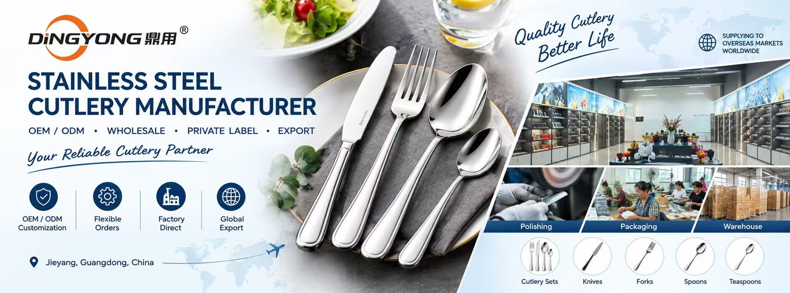

<!-- 数字统计条 -->

  

    
12<em>+</em>

    
Années d'expérience

  

  

    
5 000<em>+</em>

    
m² d'usine

  

  

    
200<em>+</em>

    
Employés

  

  

    
10M<em>+</em>

    
Pièces produites par mois

  

<!-- 我们是谁 -->

  <h2>Qui sommes-nous</h2>
  
Un partenaire couverts de confiance, basé à Jieyang (Guangdong) — le berceau chinois de l'acier inoxydable pour la table.

  

    

      

        Jieyang Dingyong Hardware &amp; Plastic Products Co., Ltd est un fabricant
        spécialisé dans les couverts, ménagères et accessoires de cuisine en acier
        inoxydable. Basés à Jieyang (Guangdong), nous servons des acheteurs B2B du
        monde entier depuis plus de dix ans, sous notre propre marque enregistrée
        DINGYONG.
      

      

        Notre site de production de plus de 5 000 m² réunit 200 employés et des
        machines de polissage CNC avancées, nous permettant de produire plus de
        10 millions de pièces par mois. Des petites commandes personnalisées aux
        contrats de grandes chaînes hôtelières, nous offrons des solutions OEM/ODM
        flexibles, adaptées à votre marché.
      

      

        ✓ <strong>Vente directe d'usine</strong> — Sans intermédiaires, à des prix compétitifs 
        ✓ <strong>Qualité garantie</strong> — Inspection avant expédition sur chaque commande, tests en laboratoire indépendant disponibles 
        ✓ <strong>Capacité de personnalisation</strong> — Gravure de logo, emballage personnalisé, couleurs PVD 
        ✓ <strong>Livraison rapide</strong> — Stock disponible, avec un planning flexible pour les commandes personnalisées
      

    

    

      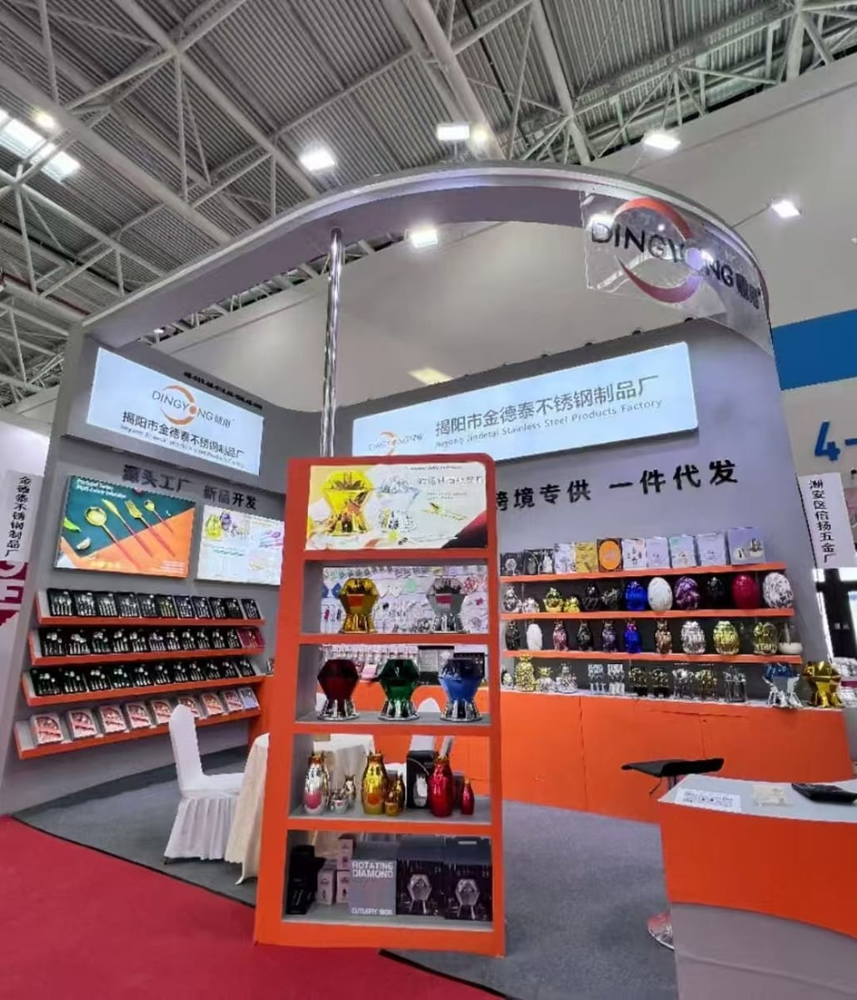
    

  

<!-- 工厂视频 + 生产流程 -->

  <h2>Au cœur de notre usine</h2>
  
Découvrez comment vos couverts sont fabriqués — de l'acier brut au produit fini.

  

    

      

        <!-- 上行 9 张（原料 → 模具 → 通道 → 压头 → 车间 → 成品仓） -->
        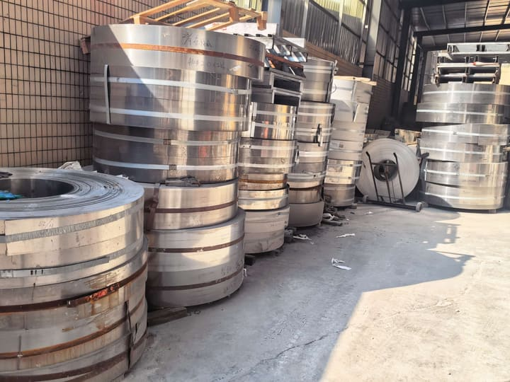
        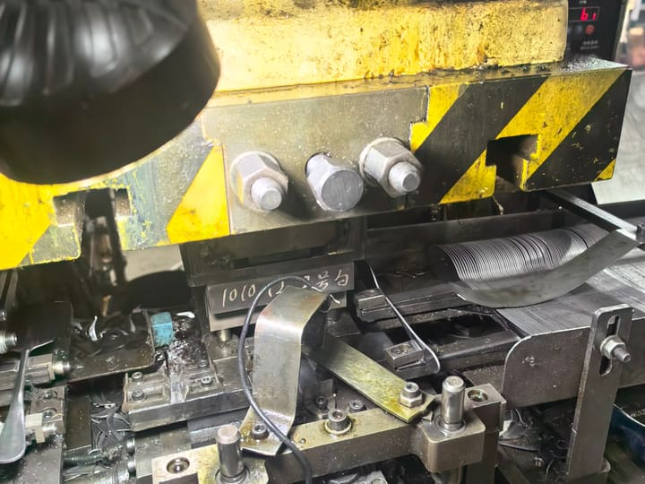
        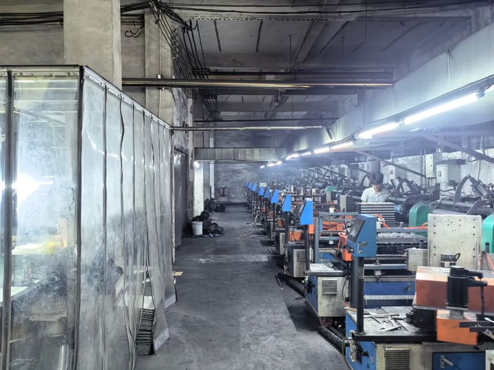
        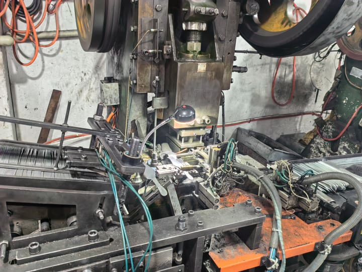
        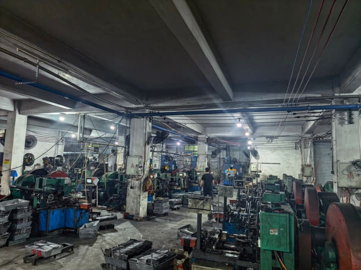
        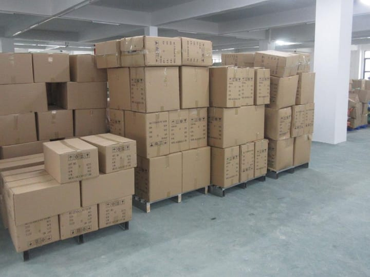
        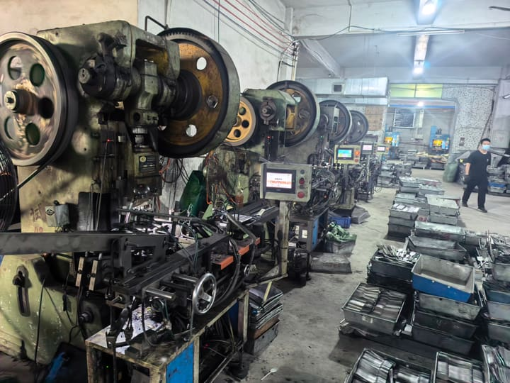
        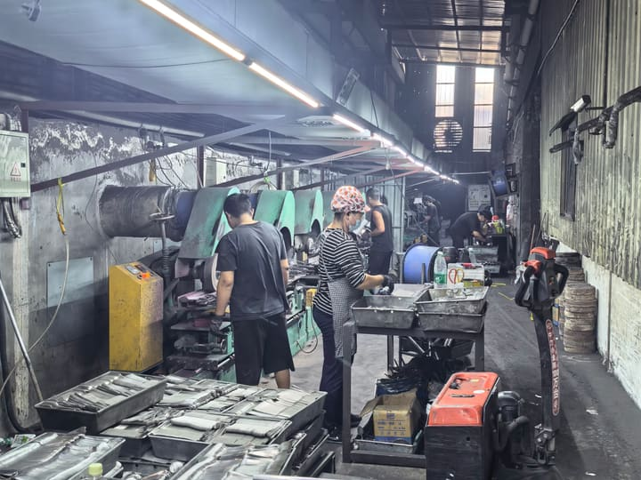
        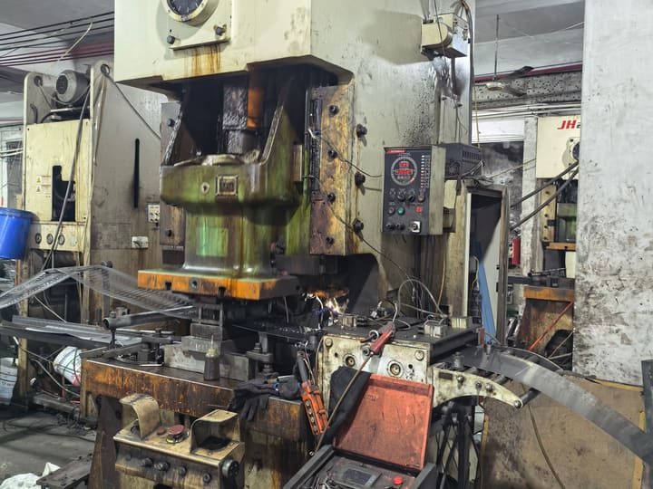
        <!-- 复制一整套：轨道滚到 -50% 时首尾重合，形成无缝循环 -->
        
        
        
        
        
        
        
        
        
      

    

    

      

        <!-- 下行另外 9 张：同一车间、不同机位，与上行不重复一张 -->
        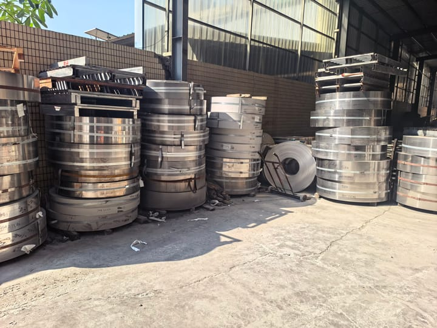
        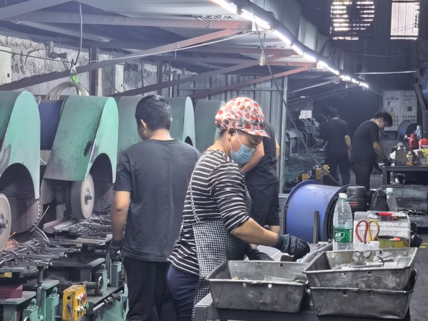
        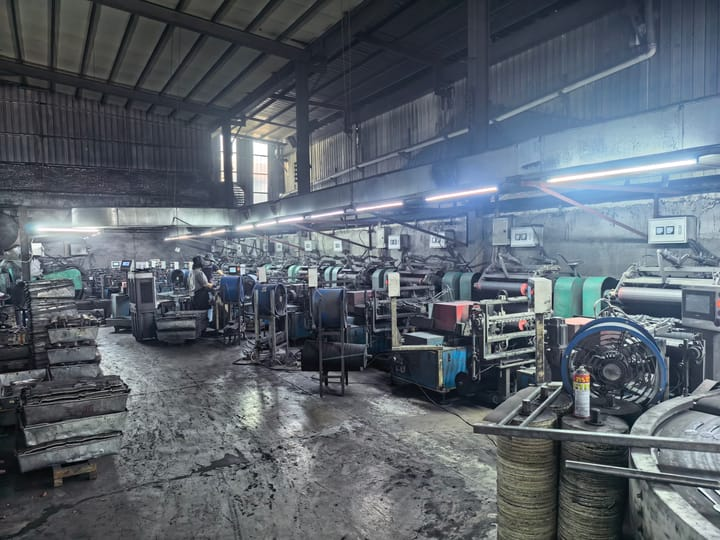
        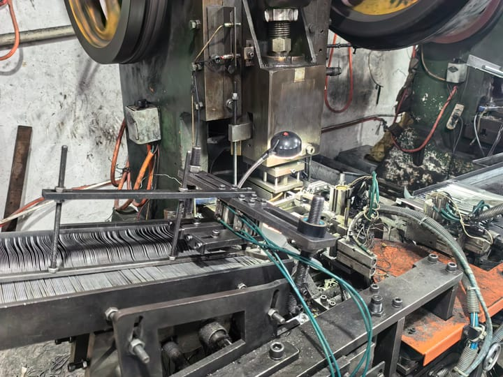
        
        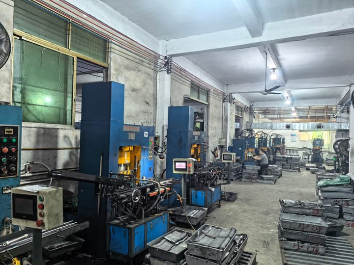
        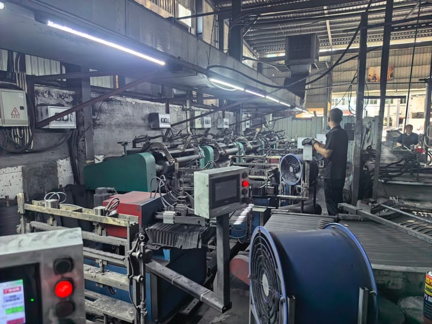
        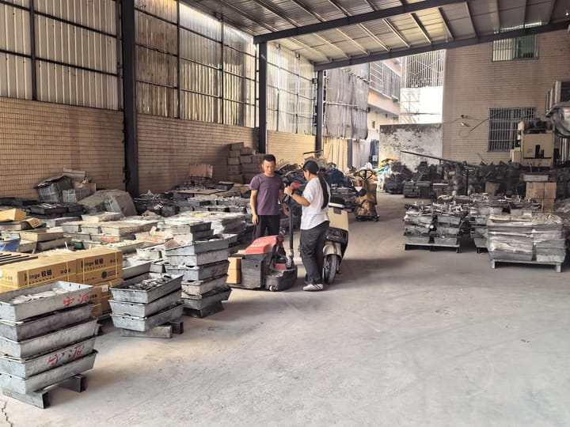
        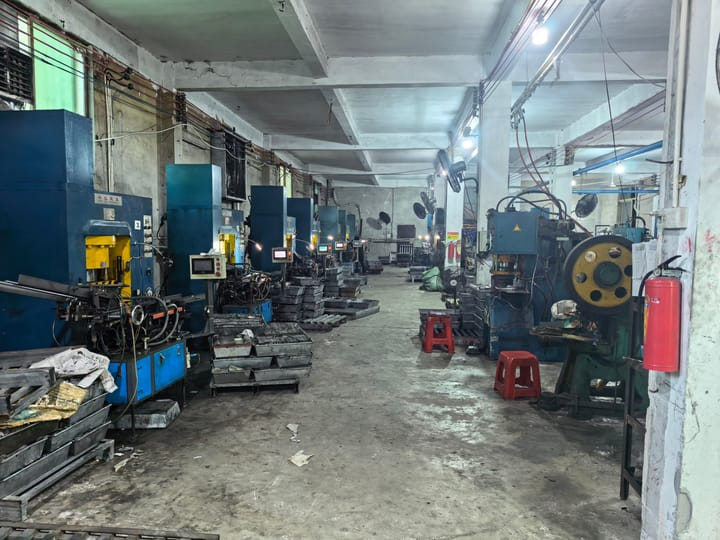
        <!-- 复制一整套：轨道滚到 -50% 时首尾重合，形成无缝循环 -->
        
        
        
        
        
        
        
        
        
      

    

  

  

    

      <iframe
        src="https://www.youtube.com/embed/rxGmVh_LP3A?modestbranding=1&controls=1&showinfo=0&rel=0&iv_load_policy=3"
        title="Visite de l'usine Ding-Yong"
        allow="accelerometer; autoplay; clipboard-write; encrypted-media; gyroscope; picture-in-picture"
        allowfullscreen>
      </iframe>
    

    

      

        
1

        

          <h4>Emboutissage &amp; formage</h4>
          
Des presses de haute précision découpent et forment les ébauches d'acier inoxydable en couteaux, fourchettes et cuillères.

        

      

      

        
2

        

          <h4>Polissage</h4>
          
Un polissage CNC en plusieurs étapes, complété à la main, donne la finition miroir signature de la maison.

        

      

      

        
3

        

          <h4>Contrôle qualité</h4>
          
Chaque lot est vérifié : finition, arêtes et sécurité au contact alimentaire, avant l'emballage.

        

      

      

        
4

        

          <h4>Emballage &amp; export</h4>
          
Coffrets cadeaux sur mesure, boîtes couleur et cartons d'export, expédiés dans le monde entier.

        

      

    

  

<!-- 质量保障 -->

  <h2>Assurance qualité</h2>
  
Chaque commande suit un processus qualité structuré — de la confirmation d'échantillon à l'inspection avant expédition.

  

    

      
<svg viewBox="0 0 24 24"><path d="M12 2l2.4 4.9 5.4.8-3.9 3.8.9 5.4L12 14.4 7.2 16.9l.9-5.4L4.2 7.7l5.4-.8L12 2z"/></svg>

      <h4>Confirmation d'échantillon</h4>
      
Validation des échantillons pré-production avant le lancement en série

    

    

      
<svg viewBox="0 0 24 24"><path d="M12 2l2.4 4.9 5.4.8-3.9 3.8.9 5.4L12 14.4 7.2 16.9l.9-5.4L4.2 7.7l5.4-.8L12 2z"/></svg>

      <h4>Inspection avant expédition</h4>
      
Chaque commande est contrôlée (finition, fonction, emballage) avant départ

    

    

      
<svg viewBox="0 0 24 24"><path d="M12 2l2.4 4.9 5.4.8-3.9 3.8.9 5.4L12 14.4 7.2 16.9l.9-5.4L4.2 7.7l5.4-.8L12 2z"/></svg>

      <h4>Tests en laboratoire indépendant</h4>
      
SGS ou autres laboratoires indépendants, organisés à la demande

    

    

      
<svg viewBox="0 0 24 24"><path d="M12 2l2.4 4.9 5.4.8-3.9 3.8.9 5.4L12 14.4 7.2 16.9l.9-5.4L4.2 7.7l5.4-.8L12 2z"/></svg>

      <h4>Audit d'usine bienvenu</h4>
      
Visitez notre usine à Jieyang ou inspectez la production en visioconférence. <a href="/visit-our-factory/">Itinéraires &amp; organisation de la visite (EN) &rarr;</a>

    

  

<!-- 产品合规 -->

  <h2>Conformité des produits</h2>
  
Une conformité documentée là où le marché l'exige — et une transparence totale là où elle ne s'applique pas.

  

    

      <figure class="compliance-doc">
        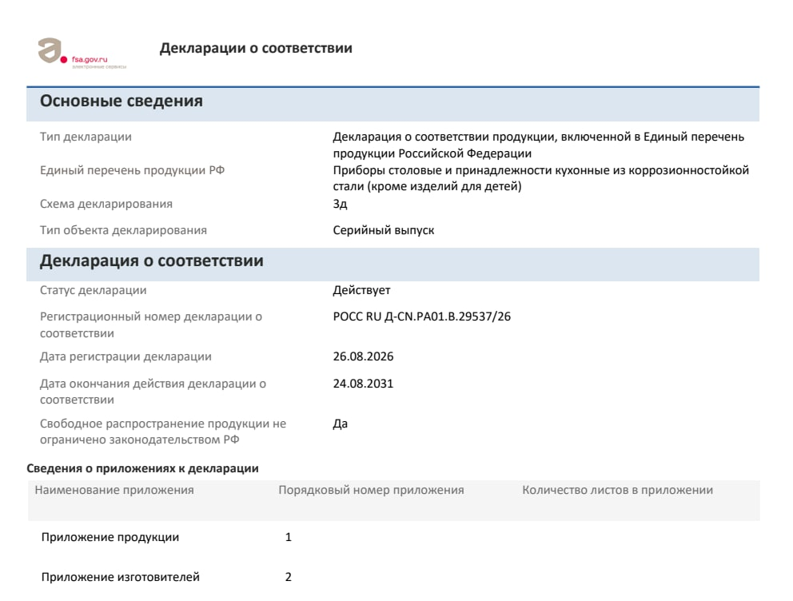
        <figcaption>Extrait du registre d'État (Rosaccreditation) — numéro d'enregistrement, statut et validité.</figcaption>
      </figure>
      

    

      
<svg viewBox="0 0 24 24"><path d="M12 1L3 5v6c0 5.6 3.8 10.7 9 12 5.2-1.3 9-6.4 9-12V5l-9-4zm-1.1 15.2L6.8 12l1.4-1.4 2.7 2.7 5.4-5.4 1.4 1.4-6.8 6.9z"/></svg>

      

        <h3>Déclaration nationale russe de conformité</h3>
        
N° РОСС RU Д-CN.РА01.В.29537/26

      

    

    <dl class="compliance-facts">
      

        <dt>Norme</dt>
        <dd>GOST R 51687-2021 — vaisselle et ustensiles de cuisine en acier inoxydable, conditions techniques générales</dd>
      

      

        <dt>Enregistrée le</dt>
        <dd>26 août 2026</dd>
      

      

        <dt>Valable jusqu'au</dt>
        <dd>24 août 2031</dd>
      

      

        <dt>Fabricant déclaré</dt>
        <dd>Jieyang Dingyong Hardware &amp; Plastic Products Co., Ltd</dd>
      

      

        <dt>Titulaire de la déclaration</dt>
        <dd>Représentant autorisé dans la Fédération de Russie</dd>
      

      

        <dt>Laboratoire d'essais</dt>
        <dd>Laboratoire accrédité, accréditation N° RA.RU.21ОМ79</dd>
      

        </dl>
      

    

    

      <strong>Portée :</strong> cette déclaration est enregistrée auprès du système national de conformité de la Fédération
      de Russie (GOST R) et est valable pour le marché russe. Elle ne constitue pas une approbation à l'échelle de
      l'Union économique eurasienne (UEE) et ne s'étend pas aux autres destinations. Pour la FDA, la LFGB ou toute
      autre exigence propre à un marché, nous organisons les tests avec un laboratoire indépendant avant expédition —
      indiquez-nous votre marché cible et nous confirmerons la documentation nécessaire.
    

  

<!-- 发展历程 -->

  <h2>Notre parcours</h2>
  

    

      
2014

      
Entrée dans l'industrie de l'acier inoxydable pour la table et début de la fabrication de couverts à Jieyang (Guangdong).

    

    

      
2016

      
Enregistrement de notre propre marque « DINGYONG », avec une identité de marque dédiée à nos gammes de produits.

    

    

      
2021

      
Standardisation de notre processus qualité — confirmation d'échantillon et inspection avant expédition sur chaque commande.

    

    

      
2023

      
Adhésion à Alibaba Station Internationale, ouverture de canaux de vente en gros en direct vers les acheteurs B2B mondiaux.

    

    

      
2024

      
Agrandissement de l'usine à plus de 5 000 m² avec des équipements et une capacité modernisés.

    

    

      
2026

      
Enregistrement de notre vaisselle en acier inoxydable sous une Déclaration nationale russe de conformité GOST R 51687-2021, ajoutant un accès documenté au marché de la Fédération de Russie.

    

  

<!-- 展会图库 -->

  <h2>Salons &amp; expositions</h2>
  
Rencontrez-nous en personne lors des salons internationaux — de vrais stands, de vraies conversations, de vrais partenariats.

  
Nos stands

  

    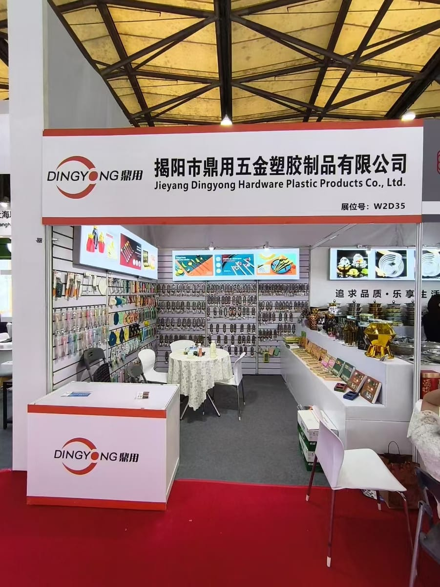
    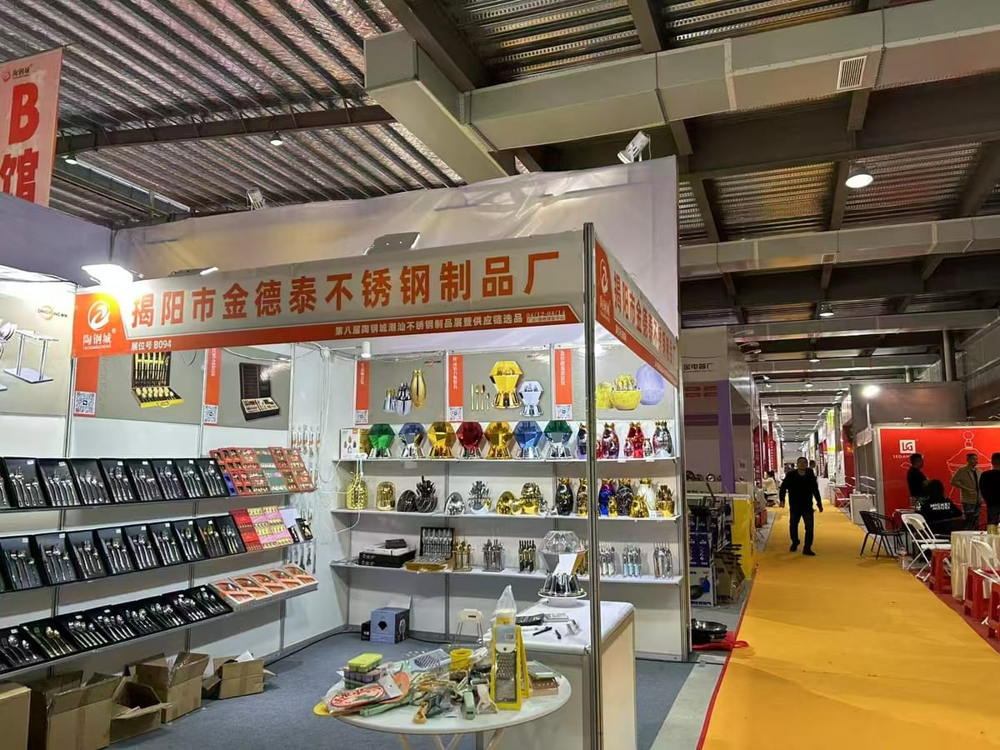
    
    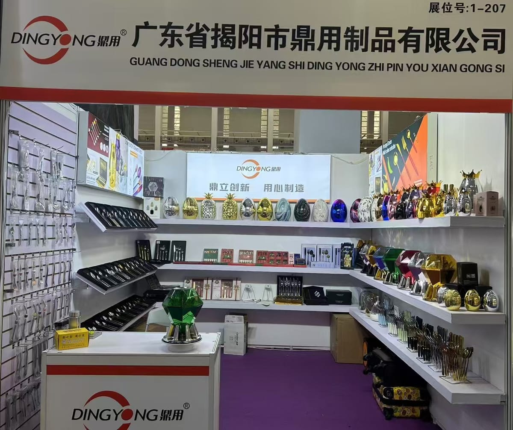
    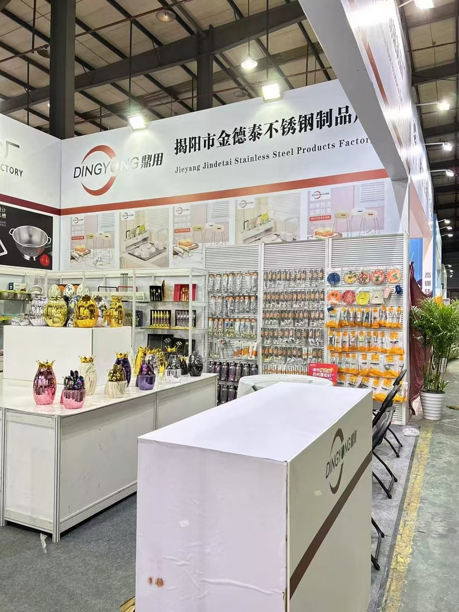
  

  
Acheteurs &amp; négociations

  

    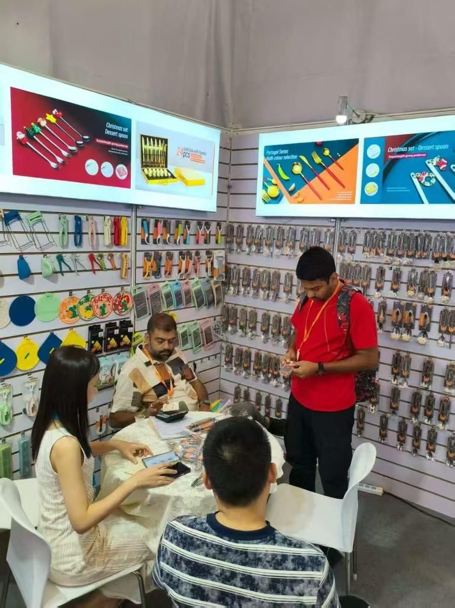
    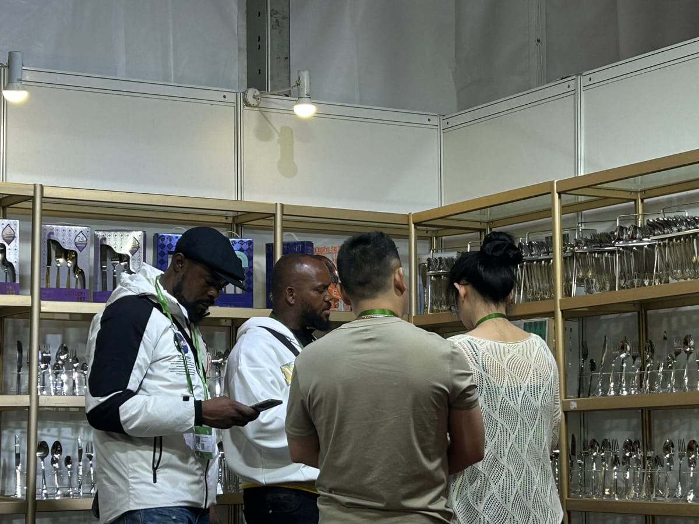
    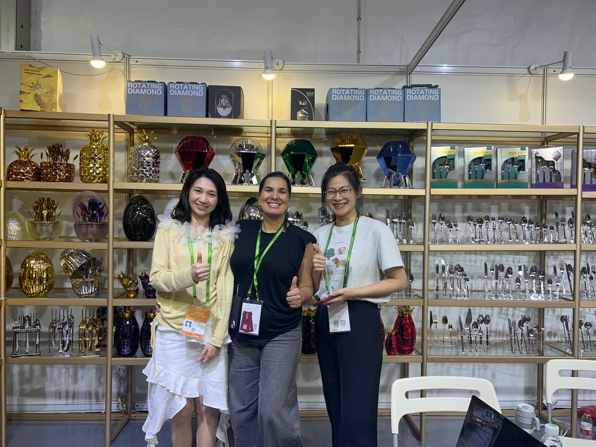
    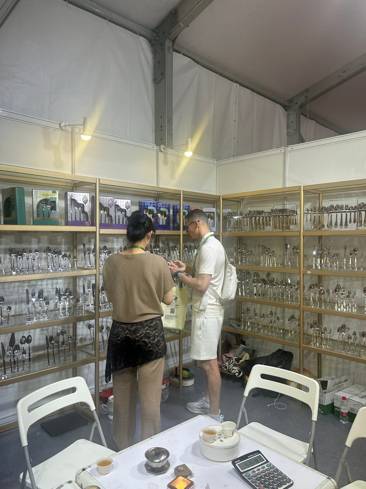
    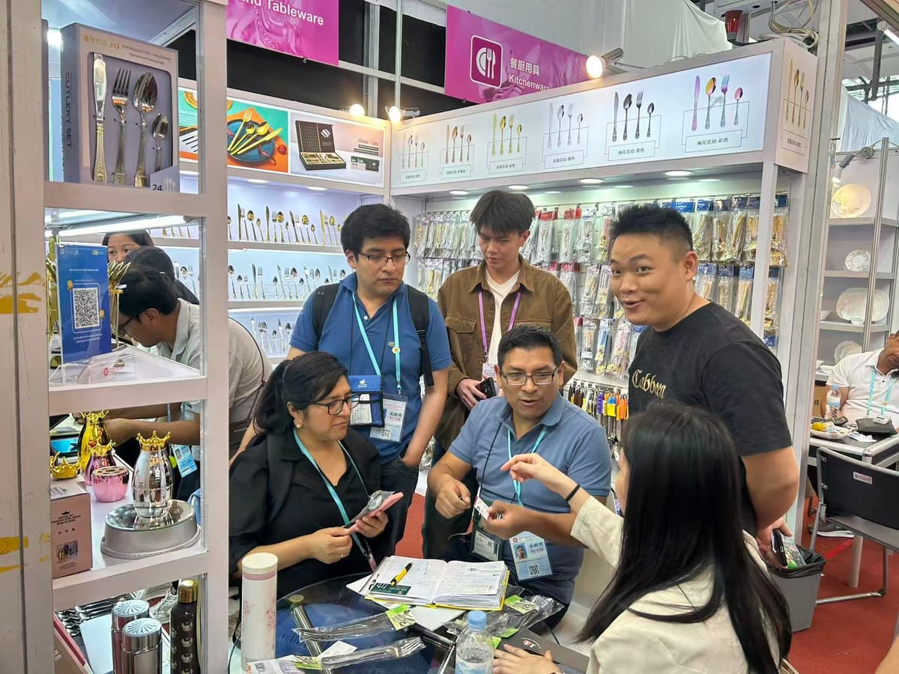
  

  
Moments avec nos clients

  

    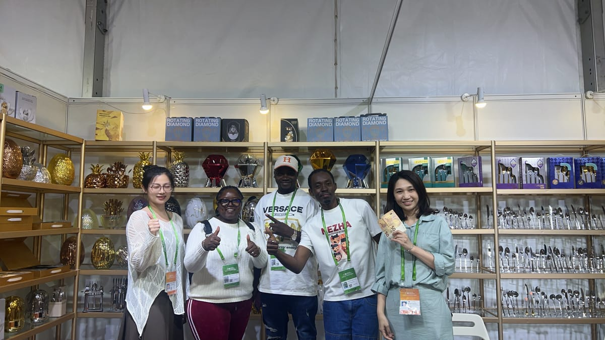
    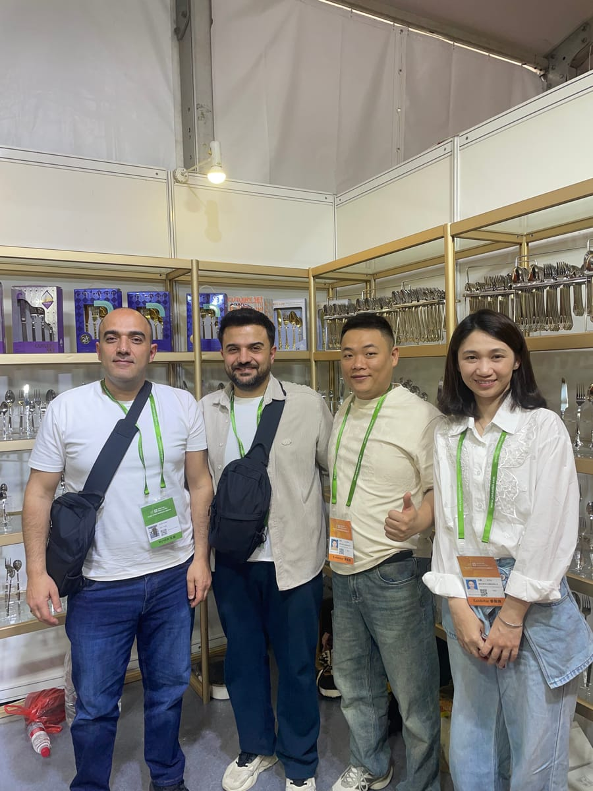
    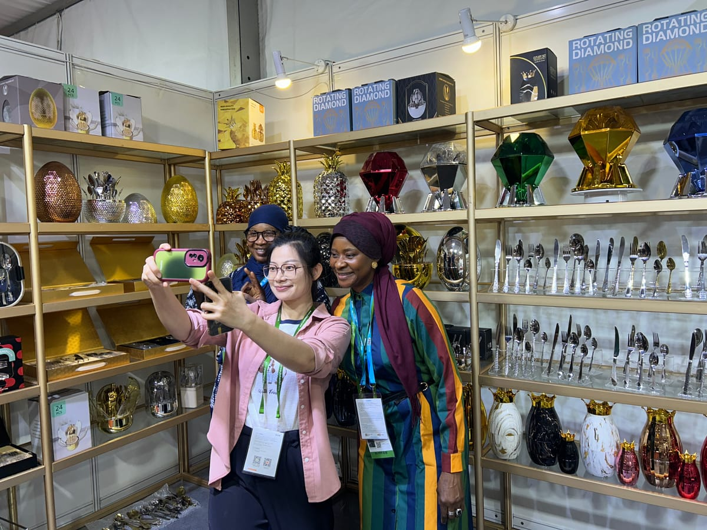
    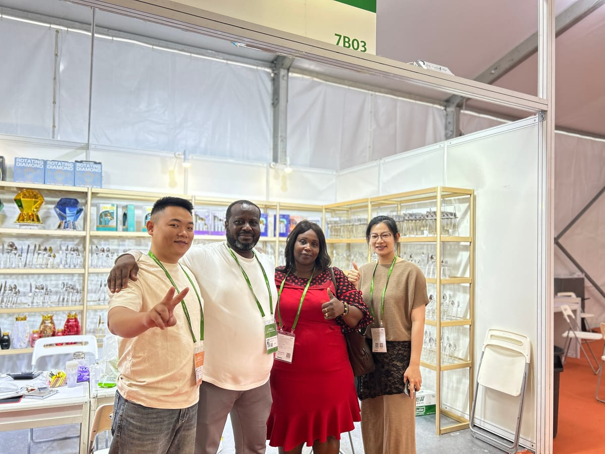
  

  

    <a href="/jinhan-fair-2026/">Jinhan Fair 2026, Guangzhou — stand 7B01 : photos, vidéo et retours des acheteurs (EN) &rarr;</a>
  

<!-- CTA 收口 -->

  <h2>Prêt à lancer votre commande ?</h2>
  
Obtenez un devis direct usine, demandez des échantillons gratuits ou parlez de votre projet OEM/ODM avec notre équipe.

  <a class="cta-btn" href="https://wa.me/8615013371880" target="_blank" rel="noopener">Obtenir un devis sur WhatsApp</a>
  

    Ou écrivez-nous à <a href="mailto:sales@ding-yong.com">sales@ding-yong.com</a> — nous répondons sous 24 heures.
  

