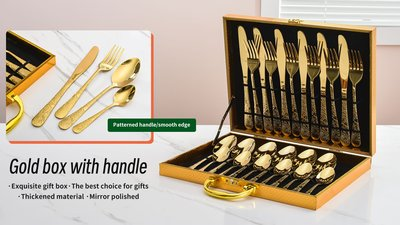
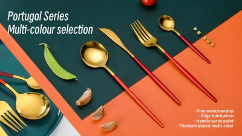
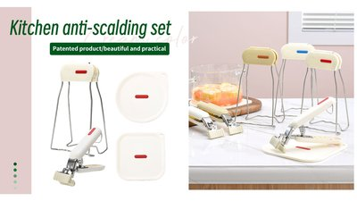
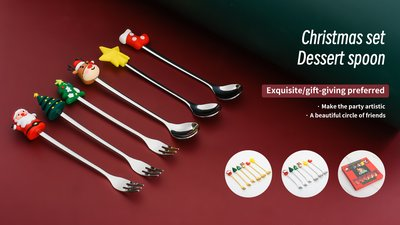

<!-- FAQ 结构化数据（与下方可见 Q&A 逐字一致） -->

<!-- 首屏横幅 -->

  <h1>JIEYANG DINGYONG HARDWARE &amp; PLASTIC PRODUCTS CO., LTD</h1>
  
Votre partenaire de confiance pour les solutions de couverts OEM/ODM

  

    ✓ Contrôle qualité avant expédition sur chaque commande
    ✓ Tests en laboratoire indépendant à la demande
    ✓ Plus de 12 ans d'expérience à l'export
  

  <a href="/fr/produits/" class="cta-button">Voir les produits</a>
  <a href="/fr/contact/" class="cta-button secondary">Demander un devis</a>

<!-- 核心数据 -->

  

    <strong>600+</strong>
    Modèles de produits
  

  

    <strong>40+</strong>
    Pays d'exportation
  

  

    <strong>10M+</strong>
    Pièces produites par mois
  

  

    <strong>200+</strong>
    Employés
  

<!-- 产品分类 -->
<section>
  <h2>Nos gammes de produits</h2>
  

    

      
      

        <h3>Ménagères et coffrets</h3>
        
Ménagères 24/72 pièces en coffret, finitions miroir et dorée — pour la vente au détail, les hôtels et les restaurants

        <a href="/fr/produits/">Voir les produits →</a>
      

    

    

      
      

        <h3>Couverts</h3>
        
Couteaux, fourchettes et cuillères en finition miroir, satinée ou titane PVD multicolore — série Portugal et designs sur mesure

        <a href="/fr/produits/">Voir les produits →</a>
      

    

    

      
      

        <h3>Accessoires de cuisine</h3>
        
Pinces anti-brûlure, maniques et demi-moufles en silicone, designs brevetés, matériaux résistants à la chaleur pour contact alimentaire

        <a href="/fr/produits/">Voir les produits →</a>
      

    

    

      
      

        <h3>Coffrets cadeaux de fêtes</h3>
        
Coffrets de cuillères et fourchettes thème Noël et fêtes, figurines amusantes et boîtes festives, parfaits pour la vente saisonnière

        <a href="/fr/produits/">Voir les produits →</a>
      

    

  

</section>

<!-- 为什么选择我们 -->
<section>
  <h2>Pourquoi choisir DINGYONG</h2>
  

    

      <h4>🏭 Vente directe d'usine</h4>
      
Site de production de 5 000 m², moules sur mesure, finitions (PVD/miroir/satin) et marquage de votre marque.

    

    

      <h4>🔬 Qualité garantie</h4>
      
Contrôle qualité interne rigoureux avec inspection avant expédition sur chaque commande.

    

    

      <h4>🚢 Production réactive</h4>
      
Planification flexible et délais optimisés pour un lancement rapide sur votre marché.

    

    

      <h4>🎨 Présence mondiale</h4>
      
Une expérience éprouvée auprès de clients en Europe, Amériques, Moyen-Orient et Asie du Sud-Est — plus de 40 pays.

    

  

</section>

<!-- 采购指南（内链博客，英文）-->
<section>
  <h2>Guides d'achat</h2>
  
Nos guides d'achat détaillés sont disponibles en anglais :

  

    
    

      <h4 style="margin-bottom:8px;">
        <a href="{{ post.url }}" style="color:#1a1a2e;text-decoration:none;">{{ post.title }}</a>
      </h4>
      
{{ post.description | truncate: 130 }}

      <a href="{{ post.url }}" style="color:#e94560;font-weight:bold;font-size:0.9em;">Lire le guide (EN) →</a>
    

    
  

</section>

<!-- 服务市场（内链市场着陆页，英文）-->
<section>
  <h2>Marchés que nous servons</h2>
  

    

      <h4>Pakistan</h4>
      
Fourniture de couverts en acier inoxydable pour importateurs et grossistes à Karachi, Lahore et dans tout le Pakistan.

      <a href="/markets/pakistan/" style="color:#e94560;font-weight:bold;font-size:0.9em;">Pour les acheteurs pakistanais (EN) →</a>
    

    

      <h4>Afrique de l'Ouest</h4>
      
Couverts et ménagères en gros pour les importateurs du Ghana, du Mali, du Togo et des pays voisins d'Afrique de l'Ouest.

      <a href="/markets/west-africa/" style="color:#e94560;font-weight:bold;font-size:0.9em;">Pour les acheteurs ouest-africains (EN) →</a>
    

  

</section>

<!-- 常见问题 -->
<section>
  <h2>Questions fréquentes</h2>
  

    

      
Fournissez-vous des échantillons gratuits ?

      

        Oui. Nous fournissons gratuitement des échantillons de nos modèles existants — vous ne payez que le transport. Des échantillons personnalisés avec votre logo peuvent également être réalisés ; contactez-nous et nous confirmerons les modalités pour votre projet.
      

    

    

      
Proposez-vous l'OEM/ODM, le logo et l'emballage personnalisés ?

      

        Oui. Nous prenons en charge la gravure laser du logo, les couleurs PVD personnalisées, les moules sur mesure et les coffrets cadeaux adaptés. Notre équipe de design interne vous accompagne du dessin au produit fini.
      

    

    

      
Comment garantissez-vous la qualité des produits ?

      

        Chaque commande passe par la confirmation d'échantillon et une inspection avant expédition. Des tests en laboratoire indépendant (type SGS) peuvent être organisés à la demande, et les audits d'usine ou inspections par visioconférence sont les bienvenus.
      

    

  

</section>
